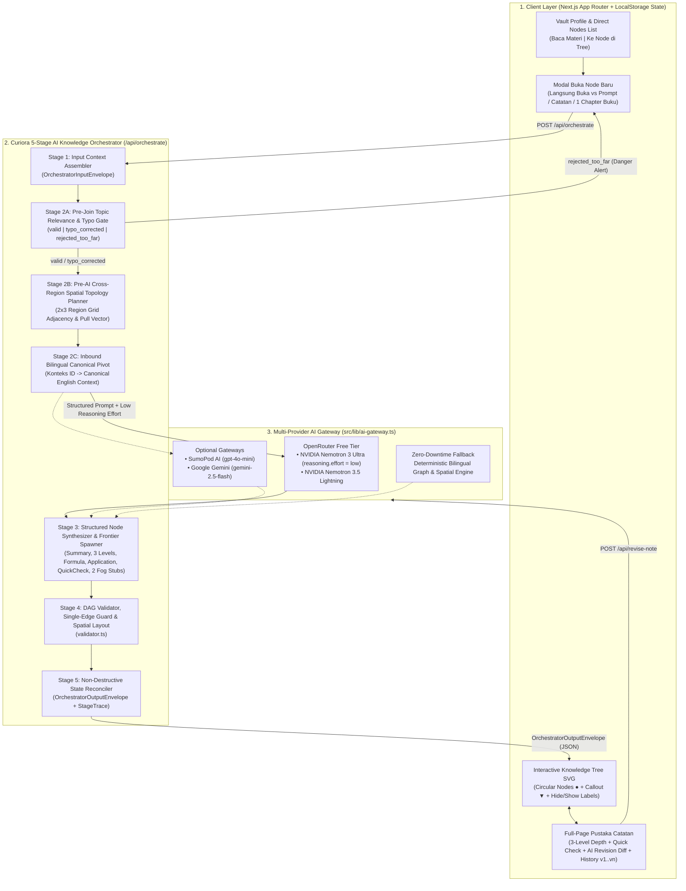

# Curiora — AI-Powered Spatial Knowledge Exploration Platform

> **Tagline:** *Where Curiosity Finds Its Way*  
> **Kompetisi:** LOGICODIX 2026 Hackathon Competition  
> **Kategori:** Web Application  
> **Subtema:** Smart & Fun Education  
> **Repositori:** `https://github.com/shinoaaa/study-explore`

---

## 1. Nama Tim dan Daftar Anggota

- **Nama Tim:** Tim Curiora
- **Daftar Anggota Tim:**
  1. **Elvina Paramita Eka Putri** — Ketua Tim (*Team Leader*)
  2. **Humairah Maidina** — Anggota (*Member*)
  3. **Stefanus Dewangga** — Anggota (*Member*)
  4. **Raid Fikri Nabil** — Anggota (*Member*)

---

## 2. Kategori, Nama Aplikasi, Deskripsi Solusi, Masalah yang Diangkat, dan Target Pengguna

### 2.1. Kategori & Nama Aplikasi
- **Kategori Aplikasi:** **Web** (*Web Application* berbasis Next.js App Router)
- **Nama Aplikasi:** **Curiora** (*Curiosity Aurora*) — *Where Curiosity Finds Its Way*

### 2.2. Masalah yang Diangkat
1. **Konsumsi AI yang Pasif & Linier (*Passive AI Chat Consumption*):**  
   Saat belajar menggunakan *chatbot* AI konvensional, pelajar hanya melakukan tanya-jawab satu arah di dalam satu utas obrolan (*scroll thread*) yang panjang. Penjelasan cepat tenggelam, tidak terlihat hubungan sebab-akibat antar-konsep, dan pelajar kehilangan gambaran besar (*big picture*).
2. **Keterbatasan Eksplorasi dari Materi Kurikulum & Tidak Tahu Apa yang Belum Diketahui (*Unknown Unknowns*):**  
   Ketika membaca bab buku sekolah/kuliah (misalnya *Sistem Pernapasan Manusia*), penjelasan buku sering berhenti pada batas bab tersebut. Pelajar tidak memiliki peta visual yang menghubungkan bab itu ke konsep lanjutan (*Hemoglobin*, *Respirasi Seluler & ATP*, *Bioenergetika*, hingga *Sensor Oksimetri*).
3. **Tersesat Saat Mengejar Minat Tanpa Peta Prasyarat & Catatan yang Terfragmentasi (*Fragmented Notes*):**  
   Pelajar yang ingin mendalami topik baru (misalnya *Mekatronika & Robotika* atau *Riset Kanker*) sering langsung melompat ke artikel tingkat lanjut tanpa mengetahui fondasi prasyaratnya, sementara catatan belajar mereka tercecer di banyak file tanpa struktur keterkaitan.

### 2.3. Deskripsi Solusi (Curiora)
**Curiora** adalah platform eksplorasi pengetahuan spasial berbasis AI (*AI-Powered Interactive Knowledge Graph*) yang mengubah percikan rasa penasaran (*spark of curiosity*) maupun catatan materi menjadi **Pohon Ilmu Interaktif (*Regional Skill Tree*)** di dalam ruang belajar terisolasi yang disebut **Knowledge Vault**.
- Menggabungkan konsep **Knowledge Vault** (ruang catatan terstruktur layaknya *Obsidian*) dengan visualisasi **6 Wilayah Rumpun Keilmuan (*6 Knowledge Regions*)** dan mekanisme **Fog of War (*Cabang Terkunci*)** layaknya *Skill Tree* gim strategi.
- Setiap node konsep dapat dibuka secara **Langsung (`Open Directly`)** atau dengan **Tambah Catatan / Materi Dulu (`Prompt`, `Catatan Kuliah`, atau `1 Chapter Buku`)**, dibaca dalam **3 tingkat kedalaman** (*Santai / Simple*, *Standar / Standard*, *Mendalam / Advanced*), diuji melalui **Uji Cepat (*Quick Check*)**, serta dikelola di dalam **Pustaka Catatan (*Knowledge Library*)** halaman penuh yang mendukung **Pratinjau Revisi AI (*AI Revision Diff Preview*)** dan **Riwayat Versi (`v1..vn`)**.

### 2.4. Target Pengguna
1. **Pelajar SMA / SMK / MA:** Siswa yang ingin memahami keterkaitan konsep pelajaran lintas mata pelajaran (Biologi, Fisika, Matematika, Informatika) maupun mempersiapkan olimpiade/riset siswa.
2. **Mahasiswa & Peneliti Muda:** Mahasiswa yang perlu memetakan prasyarat topik kuliah, merangkum bab buku referensi (*textbook chapter*), dan mengeksplorasi hubungan lintas-disiplin (mis. *Biomedis*, *Mekatronika*, *Komputasi*).
3. **Pembelajar Mandiri (*Self-Directed Learners*):** Siapa saja yang ingin membangun peta pengetahuan pribadi berbasis rasa ingin tahu secara terstruktur.

---

## 3. Daftar Fitur Utama yang Berhasil Diimplementasikan

1. **Identity-First Knowledge Vault Manager & Collapsible Clean Sidebar (`FEAT-01`):**
   - Pembuatan *Knowledge Vault* berdasarkan profil belajar (*Vault Name*, *Main Interest*, *Focus Question*, *Learning Goal*, *Related Interests*, dan *Preferred Starting Depth*) lengkap dengan tombol **Contoh Cepat (*Quick Presets*)**.
   - Filter **`Semua Vault` | `★ Ada Favorit`**, penyimpanan lokal instan, serta **Collapsible Sidebar** (sidebar kiri dapat ditutup/dibuka penuh agar kanvas kerja maksimal).
2. **Streamlined Vault Overview — Direct Nodes Action List (`FEAT-02`):**
   - Di bawah kartu **Profil Vault**, bagian **Daftar Node** langsung menampilkan seluruh node di dalam Vault lengkap dengan filter `Semua | ★ Favorit`, tanda bintang **Favorit ★**, dan **2 tombol aksi langsung** pada tiap kartu:
     - **`Baca Materi` / `Buka Node`** — langsung membuka materi konsep atau memicu pembukaan node Fog.
     - **`Ke Node di Tree`** — langsung melompat dan memfokuskan kamera ke titik node tersebut di kanvas *Pohon Ilmu*.
3. **Dual-Mode Node Input, Pre-Join Relevance Gate & True Fog-of-War Lifecycle (`FEAT-03`):**
   - **2 Opsi Pembukaan Node:** Pengguna dapat memilih **`Langsung Buka`** (AI langsung menyintesis materi berdasarkan konteks Vault) atau **`Tambah Catatan / Materi Dulu`** (menyematkan *Prompt*, *Catatan Pribadi*, atau *1 Chapter Buku* ke node tersebut).
   - **Pre-Join Topic Relevance & Typo Gate (`Stage 2A`):** Sebelum memanggil LLM, sistem memvalidasi relevansi topik terhadap identitas Vault:
     - *Valid / Relevan*: langsung diteruskan ke AI Orchestrator.
     - *Typo Ringan (`typo_corrected`)*: dikoreksi otomatis secara diam-diam tanpa pesan peringatan yang mengganggu.
     - *Melenceng Jauh (`rejected_too_far`)*: ditolak dengan peringatan merah **Danger Alert** sebelum membuang kuota API AI.
   - **True Fog-of-War Lifecycle:** Node cabang baru lahir dalam status **Fog abu-abu (`explored: false`)** yang hanya menampilkan judul topik tanpa membocorkan isi/relasi terlebih dahulu. Ketika node dibuka (`OPEN_NODE`), barulah materi disintesis dan pengguna dapat menekan **`Kembangkan Konsep Ini` (`Expand Node`)** untuk menumbuhkan cabang *Fog* berikutnya.
4. **Curiora 5-Stage AI Knowledge Orchestrator & Cross-Region Spatial Topology Planner (`FEAT-04`):**
   - Orkestrator backend (`/api/orchestrate`) mengatur kontrak input-output yang ketat (`OrchestratorInputEnvelope` $\rightarrow$ `OrchestratorOutputEnvelope`), menganalisis relasi silang (*cross-links*) dengan node yang sudah terbuka di Vault, serta menata tata letak node lintas-wilayah menggunakan **Cross-Region Pull Vector** (`validator.ts`).
5. **Circular Skill Tree Canvas, Top Callout Box `▼`, Hide/Show Labels & Dynamic Wave Stagger (`FEAT-05`):**
   - Setiap node dirender sebagai **lingkaran bersih (`r = 22px`)** di dalam **6 Wilayah Rumpun Ilmu (*Hybrid Soft Outward Region Aura*)** dengan 5 jenis garis relasi (`prerequisite`, `extension`, `application`, `contrasts`, `cross_disciplinary`).
   - Judul node tampil sebagai **kotak keterangan (*callout box*) dengan panah `▼` tepat di atas lingkaran node**.
   - Tombol ikon **Mata (`Hide / Show Labels`)** di toolbar kanvas: saat disembunyikan, seluruh label di atas node hilang agar graf bersih, dan **ketika salah satu lingkaran node diklik, hanya label keterangan node tersebut yang muncul**.
   - Posisi node diatur dinamis maju-mundur (*Organic Wave Stagger X/Y*) agar label tidak saling bertumpuk.
6. **Full-Page Pustaka Catatan (Knowledge Library), Slide-Over Drawer & AI Revision Diff Preview (`FEAT-06`):**
   - Pembaca **1 halaman penuh (*Single-Column Full-Page Reader*)** yang nyaman dibaca tanpa terpotong panel sempit.
   - **Slide-Over Drawer `Daftar Node`** dengan pencarian instan, filter status, filter **Favorit ★**, dan **Filter per Bidang Ilmu (6 Regions)**.
   - Fitur **`Edit Catatan`**, **`Minta AI Revisi`** (`/api/revise-note`) yang menampilkan **Kotak Pratinjau Usulan AI (*Diff Preview*)** sebelum diterapkan, serta **Riwayat Revisi (`v1, v2, ...`)** dengan tombol *Pulihkan (Restore)*.
7. **3 Tingkat Kedalaman Penjelasan, 1-Click Quick Check, Light/Dark Mode & Bilingual EN/ID (`FEAT-07`):**
   - Tab **`Santai (Simple)`**, **`Standar (Standard)`**, dan **`Mendalam (Advanced)`** beserta kartu **Rumus / Prinsip Inti** dan **Penerapan Nyata**.
   - Kuis interaktif **Uji Cepat (*Quick Check*)** untuk menandai node sebagai **`Sudah Paham ✓` (`Reviewed`)**.
   - Dukungan penuh **Light Mode / Dark Mode** dan bahasa **Indonesia / Inggris (`ID | EN`)** secara *real-time*.

---

## 4. Teknologi yang Digunakan

| Komponen | Teknologi / Layanan | Kegunaan dalam Curiora |
| :--- | :--- | :--- |
| **Framework Utama** | **Next.js 14.2** (App Router, React 18, TypeScript 5) | Arsitektur full-stack web app, komponen UI reaktif, dan API Route Handlers (`/api/orchestrate`, `/api/revise-note`, `/api/explore`, `/api/expand`). |
| **Library UI & Graf** | **Tailwind CSS 3.4**, **Lucide React**, **Custom SVG DAG Engine** | Styling responsif Light/Dark mode, ikonografi vektor, serta rendering kanvas *Knowledge Tree* interaktif (zoom, pan, minimap, kurva Bézier, & *Region Aura*). |
| **Database & Storage** | **Browser `localStorage` Engine** (`curiora_clean_single_vault_v1`) | Penyimpanan *local-first* berlatensi nol untuk seluruh *Knowledge Vault*, graf node/edge, catatan materi, favorit, riwayat revisi (`v1..vn`), tema, dan bahasa tanpa beban setup database eksternal. |
| **API & Layanan AI Pihak Ketiga** | **OpenRouter API** (`https://openrouter.ai/api/v1`) | Gateway LLM utama yang menjalankan **`NVIDIA: Nemotron 3 Ultra (free)`** (`nvidia/nemotron-3-ultra-550b-a55b:free`) dan **`NVIDIA: Nemotron 3.5 Lightning (free)`** (`nvidia/nemotron-3.5-lightning:free`). |
| **Gateway AI Alternatif (Opsional)** | **SumoPod AI Gateway** (`https://ai.sumopod.com/v1`) & **Google Gemini API** | Opsi penyedia AI cadangan (`gpt-4o-mini` / `gemini-2.5-flash`) yang dapat diaktifkan cukup melalui variabel lingkungan `.env.local`. |

---

## 5. Diagram Arsitektur Sistem dan Alur Data

Diagram arsitektur lengkap tersedia dalam format **Draw.io** di [`docs/Curiora_AI_Orchestrator_Architecture.drawio`](docs/Curiora_AI_Orchestrator_Architecture.drawio) dan gambar PNG beresolusi tinggi di [`docs/Curiora_AI_Orchestrator_Architecture.png`](docs/Curiora_AI_Orchestrator_Architecture.png):


### 5.1. Diagram Alur Sistem & Data (Mermaid)


### 5.2. Penjelasan Alur Data (*End-to-End Data Flow*)
1. **Input Pengguna (`Client` $\rightarrow$ `Stage 1`):** Pengguna membuka node Fog atau menekan `+ Node Baru` (memilih *Langsung Buka* atau melampirkan *Prompt / Catatan / 1 Chapter Buku*). Frontend mengirim payload `OrchestratorInputEnvelope` ke `POST /api/orchestrate`.
2. **Validasi Relevansi & Perencanaan Spasial (`Stage 2A` & `Stage 2B`):**
   - `Stage 2A` memeriksa kecocokan topik dengan identitas Vault. Jika melenceng jauh (mis. input resep masakan di dalam Vault Medis), request langsung dihentikan dan mengembalikan `validationGate.status = "rejected_too_far"` untuk menampilkan *Danger Alert* di UI. Jika terdapat salah ketik ringan (`typo_corrected`), ejaan diperbaiki otomatis.
   - `Stage 2B` menghitung kepadatan node per wilayah (*6 Knowledge Regions*) dan menentukan kandidat wilayah tetangga terdekat untuk mencegah garis relasi yang semrawut.
3. **Bilingual Canonical Pivot & Eksekusi LLM (`Stage 2C` & `Stage 3`):**
   - `Stage 2C` menyusun konteks kanonik Bahasa Inggris (`canonicalEnglishTopic` & `canonicalEnglishVaultInterest`) agar model penalaran **`NVIDIA: Nemotron 3 Ultra (free)`** bekerja pada akurasi sains tertinggi dengan parameter `reasoning: { effort: "low" }` (respons cepat ~6–12 detik tanpa *timeout*) dan menghasilkan nilai JSON langsung dalam bahasa aktif pengguna (`id` atau `en`), dibantu oleh **`NVIDIA: Nemotron 3.5 Lightning (free)`** bila diperlukan lokalisasi tambahan.
4. **Validasi DAG, Tata Letak Dinamis & Rekonsiliasi State (`Stage 4` & `Stage 5`):**
   - `Stage 4` (`src/lib/validator.ts`) memvalidasi bahwa graf tetap berupa *Directed Acyclic Graph* (DAG) bebas siklus, membatasi relasi silang agar rapi, serta menata koordinat `(x, y)` node dengan *Organic Wave Stagger* dan *Cross-Region Pull Vector*.
   - `Stage 5` mengembalikan `OrchestratorOutputEnvelope` ke frontend untuk langsung dirender di kanvas **Pohon Ilmu** dan disimpan ke `localStorage`.

---

## 6. Panduan Instalasi, Konfigurasi, dan Menjalankan Aplikasi

### 6.1. Prasyarat Sistem
- **Node.js** versi `18.17+` atau `20+` / `22+`
- **npm** (bawaan Node.js)
- Koneksi internet (untuk pemanggilan API OpenRouter; aplikasi tetap memiliki *Offline Deterministic Fallback* jika dijalankan tanpa internet)

### 6.2. Langkah Instalasi & Menjalankan di Lokal (`localhost:3000`)
1. **Clone repositori dan masuk ke direktori proyek:**
   ```bash
   git clone https://github.com/shinoaaa/study-explore.git
   cd study-explore
   ```
2. **Instal seluruh dependensi:**
   ```bash
   npm install
   ```
3. **Salin file konfigurasi `.env.example` menjadi `.env.local`:**
   ```bash
   cp .env.example .env.local
   ```
   *(Di Windows PowerShell: `Copy-Item .env.example .env.local`)*
4. **Isi variabel `OPENROUTER_API_KEY` di dalam `.env.local`** (lihat panduan cepat mengambil API Key gratis tanpa kartu kredit pada sub-bab 6.3 di bawah).
5. **Jalankan server development:**
   ```bash
   npm run dev
   ```
6. **Buka aplikasi di browser:**  
   Kunjungi **`http://localhost:3000`**.

*(Untuk menjalankan build produksi: jalankan `npm run build` lalu `npm run start`).*

### 6.3. Konfigurasi Tambahan Fitur AI (100% Gratis via OpenRouter)
Agar fitur **Live AI Node Synthesis**, **Expand Fog Branches**, dan **Minta AI Revisi** menggunakan model **`NVIDIA: Nemotron 3 Ultra (free)`** secara langsung:
1. Buka [https://openrouter.ai/settings/keys](https://openrouter.ai/settings/keys) dan masuk menggunakan akun Google atau GitHub (**100% gratis, tidak memerlukan kartu kredit**).
2. Klik tombol **Create Key**, beri nama bebas (misalnya `curiora-test`), lalu salin token yang berawalan `sk-or-v1-...`.
3. Tempelkan token tersebut ke variabel `OPENROUTER_API_KEY` di dalam file `.env.local`. Sistem akan otomatis memilih model gratis NVIDIA Nemotron tanpa perlu konfigurasi lain.

### 6.4. Daftar Variabel Lingkungan (`.env.example`)
Berikut adalah daftar lengkap variabel lingkungan yang tersedia di [`.env.example`](.env.example):

| Nama Variabel | Wajib / Opsional | Nilai Default / Contoh | Keterangan |
| :--- | :---: | :--- | :--- |
| `AI_PROVIDER` | Opsional | `auto` | Mode pemilihan provider AI (`auto`, `openrouter`, `sumopod`, atau `gemini`). Pada mode `auto`, sistem otomatis mendeteksi API Key yang terisi. |
| `OPENROUTER_API_KEY` | **Direkomendasikan** | `sk-or-v1-...` | API Key gratis dari OpenRouter untuk menjalankan model NVIDIA Nemotron. |
| `OPENROUTER_BASE_URL` | Opsional | `https://openrouter.ai/api/v1` | Endpoint standar OpenAI-compatible milik OpenRouter. |
| `OPENROUTER_MODEL` | Opsional | `nvidia/nemotron-3-ultra-550b-a55b:free` | Model penalaran utama (**NVIDIA: Nemotron 3 Ultra (free)**). |
| `OPENROUTER_TRANSLATOR_MODEL` | Opsional | `nvidia/nemotron-3.5-lightning:free` | Model pendamping cepat untuk lokalisasi & fallback (**NVIDIA: Nemotron 3.5 Lightning (free)**). |
| `SUMOPOD_API_KEY` | Opsional | *(kosong)* | API Key opsional jika pengguna ingin menggunakan gateway SumoPod AI. |
| `SUMOPOD_BASE_URL` | Opsional | `https://ai.sumopod.com/v1` | Base URL untuk SumoPod AI Gateway. |
| `SUMOPOD_MODEL` | Opsional | `gpt-4o-mini` | Model default saat menggunakan SumoPod AI Gateway. |
| `GEMINI_API_KEY` | Opsional | *(kosong)* | API Key opsional dari Google AI Studio (cadangan). |
| `GEMINI_MODEL` | Opsional | `gemini-2.5-flash` | Model default saat menggunakan Google Gemini API. |

---

## 7. Akun Demonstrasi (Autentikasi)

- **Tidak Memerlukan Login / Akun Demonstrasi (*Zero-Friction Access*):**  
  Sesuai prinsip desain *Local-First Knowledge Vault* (BR-01 & Out-of-Scope MVP), Curiora **tidak menerapkan gerbang login/autentikasi tertutup**.
- **Cara Pengujian Langsung oleh Juri / Penguji:**
  1. Begitu membuka `http://localhost:3000`, juri langsung masuk ke **Workspace Curiora** tanpa perlu memasukkan email/password.
  2. Sudah tersedia **1 Starter Vault siap uji (`Pernapasan × Medis` / `Respiration × Medicine`)** yang berisi node terbuka dan node *Fog of War* sehingga juri dapat langsung menguji fitur **Pohon Ilmu**, **Hide/Show Labels**, **Buka Node Baru (Validasi Typo vs Danger Alert)**, **Expand Node**, **Uji Cepat (*Quick Check*)**, hingga **Pustaka Catatan & Revisi AI** dalam hitungan detik, maupun membuat Vault baru dari nol melalui tombol **`+ Buat Vault Baru`**.

---

## 8. Dokumentasi Penggunaan AI

Curiora menggunakan AI secara terukur melalui lapisan orkestrasi **`src/lib/ai-orchestrator.ts`** dan gateway **`src/lib/ai-gateway.ts`**:

1. **Model AI & Layanan yang Digunakan:**
   - **Model Utama (OpenRouter Free Tier):** `nvidia/nemotron-3-ultra-550b-a55b:free` (**NVIDIA: Nemotron 3 Ultra (free)**) dengan konfigurasi `reasoning: { effort: "low" }` dan ekstraktor JSON tahan blok `<think>`.
   - **Model Pendamping & Fallback Rantai Gratis (OpenRouter):** `nvidia/nemotron-3.5-lightning:free` (**NVIDIA: Nemotron 3.5 Lightning (free)**) serta `nvidia/nemotron-3-nano-omni-30b-a3b-reasoning:free`.
2. **Endpoint & Fitur Aplikasi yang Memanfaatkan AI:**
   - **`POST /api/orchestrate` (`src/app/api/orchestrate/route.ts`):**
     - `SEED_FIRST_NODE`: Menyintesis node akar pertama saat membuat Vault baru beserta 2 cabang *Fog Node* awal yang spesifik.
     - `OPEN_NODE` & `BRANCH_NEW_NODE`: Menyintesis ringkasan konsep (`summary`), 3 tingkat kedalaman (`simple`, `standard`, `deep`), rumus/prinsip inti (`formula`), contoh penerapan nyata (`application`), kuis 3 opsi (`quickCheck`), referensi ilmiah (`reference`), serta mendeteksi relasi silang (`crossLinks`) dengan node yang sudah ada di dalam Vault.
     - `EXPAND_FOG_BRANCHES`: Menghasilkan 2 cabang *Fog Node* baru yang spesifik terhadap konteks node induk dan minat utama Vault.
   - **`POST /api/revise-note` (`src/app/api/revise-note/route.ts`):**
     - Menerima instruksi revisi dari pengguna di halaman **Pustaka Catatan** dan menghasilkan draf pembaruan penjelasan 3-level beserta alasan perubahannya (`rationale`) untuk ditinjau pada kotak **Pratinjau Usulan AI** sebelum disimpan menjadi versi baru (`v2, v3, ...`).
   - **`POST /api/explore` & `POST /api/expand`:** Endpoint kompatibilitas pembangkitan graf eksplorasi dan ekspansi cabang.
3. **Penanganan Kegagalan (*Resilient Fallback Mechanism*):**
   - Apabila API Key tidak diisi, kuota *rate-limit* publik sedang penuh, atau koneksi internet terputus, orkestrator otomatis beralih ke **Deterministic Bilingual Synthesis Engine** sehingga aplikasi dijamin **tidak pernah mengalami *crash* atau layar kosong (*zero downtime*)**.

---

## 9. Atribusi Seluruh Template, Aset, Dataset, dan Kode Pihak Ketiga

1. **Template Desain & Komponen UI:**
   - **100% Custom UI Architecture:** Seluruh antarmuka pengguna Curiora (Dashboard, Kartu Vault, Kanvas SVG *Knowledge Tree*, *Region Aura*, *Concept Reader*, dan *Full-Page Knowledge Library*) dirancang dan dikodekan secara mandiri menggunakan **Tailwind CSS** tanpa menggunakan template berbayar atau tema pihak ketiga.
2. **Pustaka & Kode Pihak Ketiga (*Open-Source Libraries*):**
   - **Next.js** oleh Vercel — Lisensi MIT (`https://nextjs.org`)
   - **React & React DOM** oleh Meta Open Source — Lisensi MIT (`https://react.dev`)
   - **Tailwind CSS** oleh Tailwind Labs — Lisensi MIT (`https://tailwindcss.com`)
   - **Lucide React** oleh Lucide Contributors — Lisensi ISC (`https://lucide.dev`)
   - **TypeScript** oleh Microsoft — Lisensi Apache-2.0 (`https://www.typescriptlang.org`)
3. **Aset Visual & Ikonografi:**
   - Seluruh ikon antarmuka menggunakan pustaka vektor open-source **Lucide Icons** (Lisensi ISC) dan elemen grafik SVG yang dibuat secara programatik di dalam kode aplikasi.
4. **Dataset Starter Vault & Referensi Materi Ilmiah Terbuka:**
   - Data *Starter Vault* (`src/lib/preset-vaults.ts`) disusun secara orisinal untuk keperluan edukasi dan demonstrasi dengan merujuk pada literatur ilmiah terbuka:
     - *OpenStax Biology 2e* oleh Rice University — Lisensi Creative Commons Attribution 4.0 International (**CC BY 4.0**, `https://openstax.org/details/books/biology-2e`).
     - Rujukan bibliografi akademik: *Campbell Biology (12th Edition)* dan *Guyton and Hall Textbook of Medical Physiology*.

---

## 10. Batasan Sistem & Standar Repositori (LOGICODIX 2026)

1. **Aturan Bisnis Inti Sistem (`BR-01` s/d `BR-09`):**
   - Isolasi penuh antar-*Knowledge Vault* (`BR-01`), pemisahan tegas relasi `prerequisite` vs keterkaitan lain (`BR-02`), kewajiban alasan ilmiah pada setiap *edge* (`BR-03`), pengelompokan ke dalam **6 Knowledge Regions** (`BR-04`), wajib minimal 1 jembatan lintas-disiplin (`BR-05`), validasi *Directed Acyclic Graph* bebas siklus (`BR-06`), serta eksplorasi terbuka tanpa batas persentase tamat 100% (`NFR-11`).
2. **Standar Commit & Kepatuhan Repositori:**
   - Mengikuti format **Conventional Commits** (`feat:`, `fix:`, `docs:`, `refactor:`, `chore:`) dengan riwayat *incremental* yang jujur tanpa manipulasi history (`git push --force` / `rebase`), serta menjaga keamanan kredensial melalui `.gitignore` dan `.env.example`.
