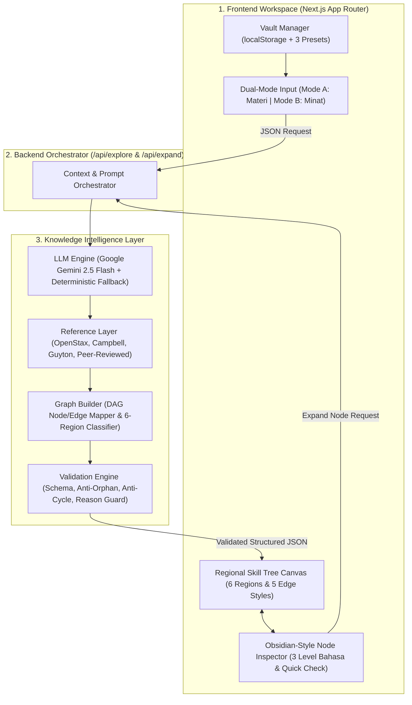

# NexusVault AI — AI-Powered Knowledge Exploration Platform

> **Kompetisi:** LOGICODIX 2026 Hackathon Competition  
> **Kategori:** Web Application  
> **Subtema:** 1. Smart & Fun Education  
> **Repositori:** `https://github.com/shinoaaa/study-explore`

---

## 1. Identitas Tim & Proyek

- **Nama Aplikasi:** NexusVault AI
- **Subtema:** Smart & Fun Education
- **Kategori:** Web
- **Target Pengguna:** Pelajar SMA/SMK/MA dan Mahasiswa yang ingin mengeksplorasi materi pelajaran lebih dalam maupun membangun jalur belajar mandiri berdasarkan minat dan tujuan personal.

---

## 2. Latar Belakang Masalah

1. **Keterbatasan Eksplorasi dari Materi Kurikulum (Kondisi A):**  
   Ketika pelajar membaca bab buku paket sekolah (misalnya Biologi bab *Sistem Pernapasan Manusia*) dan penasaran bagaimana oksigen yang dihirup digunakan oleh sel untuk mencetak energi, penjelasan di buku paket sering berhenti pada batas ruang lingkup bab tersebut. Pelajar tidak memiliki peta yang menghubungkan materi bab tersebut ke konsep lanjutan seperti *Hemoglobin*, *Respirasi Seluler*, *Metabolisme Energi*, *Bioenergetika*, maupun *VO2 Max*.
2. **Tersesat Saat Mengejar Minat Tanpa Peta Prasyarat (Kondisi B):**  
   Sebaliknya, pelajar yang memiliki minat atau tujuan spesifik (misalnya ingin memahami *Bagaimana Sel Kanker Berkembang*) sering langsung kewalahan saat membaca artikel ilmiah di internet karena melompat ke materi tingkat lanjut tanpa mengetahui anak tangga fondasi/prasyaratnya (*Biologi Sel* $\rightarrow$ *Struktur DNA* $\rightarrow$ *Mutasi Genetik* $\rightarrow$ *Regulasi Siklus Sel* $\rightarrow$ *Mekanisme Tumor*).
3. **Keterbatasan Chatbot & Mind Map Biasa:**  
   Mesin pencari dan *chatbot* linier hanya menjawab apa yang ditanyakan, padahal pelajar yang baru mulai belajar sering kali *"tidak tahu apa yang belum mereka ketahui"*.

**Solusi NexusVault AI:**  
Platform berbasis AI yang **memetakan** materi pembelajaran maupun ketertarikan pribadi ke dalam peta pengetahuan interaktif (*Interactive Knowledge Graph*). Menggabungkan konsep **Knowledge Vault** (ruang catatan terisolasi layaknya *Obsidian*) dengan visualisasi **Regional Skill Tree** (peta berkuadran lintas-bidang layaknya *Path of Exile*).

---

## 3. Batasan Aplikasi & Aturan Bisnis (AI & System Guardrails)

Dokumen ini sekaligus menjadi acuan batasan sistem (*system boundaries*) yang wajib dipatuhi oleh seluruh komponen aplikasi:

### 3.1. Business Rules (BR) yang Mengikat Sistem
- **BR-01 (Vault Isolation Rule):** Pengguna tidak dapat melempar input di ruang kosong; setiap topik eksplorasi wajib dibuat di dalam sebuah **Knowledge Vault** tersendiri agar graf dan progres belajar antar-topik tidak tercampur.
- **BR-02 (Pemisahan Prasyarat vs Keterkaitan Biasa):** Tidak semua konsep yang berkaitan boleh dilabeli sebagai prasyarat (`prerequisite`). Label `prerequisite` hanya sah jika Konsep A mutlak harus dipahami terlebih dahulu sebelum Konsep B.
- **BR-03 (Kewajiban Alasan Hubungan / Mandatory Edge Reason):** Setiap garis penghubung (*edge*) antar-konsep wajib memiliki alasan ilmiah tertulis (`reason`) yang menjelaskan mengapa kedua konsep tersebut saling terhubung.
- **BR-04 (Sistem 6 Knowledge Regions ala Path of Exile):** Setiap node wajib dipetakan ke salah satu dari 6 rumpun keilmuan:
  1. `REG-01`: **Natural & Life Sciences** (Biologi, Kimia, Fisika, Kebumian)
  2. `REG-02`: **Health, Medicine & Performance** (Kedokteran, Fisiologi, Gizi, Olahraga)
  3. `REG-03`: **Technology, Computing & AI** (Ilmu Komputer, Bioinformatika, Data Science, AI)
  4. `REG-04`: **Engineering & Applied Systems** (Teknik Biomedis, Elektro, Mesin, Lingkungan)
  5. `REG-05`: **Formal Logic & Mathematics** (Matematika, Statistika, Probabilitas)
  6. `REG-06`: **Social, Economy & Humanities** (Psikologi, Ekonomi, Kebijakan Publik, Humaniora)
- **BR-05 (Anti-Filter Bubble Rule):** Meskipun jalur disesuaikan dengan minat pengguna, setiap Vault wajib menyertakan minimal 1 cabang lintas disiplin (`cross_disciplinary` / lintas-Region) untuk membuka wawasan bidang baru.
- **BR-06 (DAG & Anti-Orphan Validation):** Struktur graf wajib berupa *Directed Acyclic Graph* (DAG) tanpa siklus pada relasi `prerequisite`, tanpa duplikasi node, dan setiap `source`/`target` pada *edge* wajib merujuk ke ID node yang valid.
- **BR-07 (Kesamaan Mesin Mode A & Mode B):** Eksplorasi dari Materi Kurikulum (Mode A) dan Eksplorasi dari Minat/Tujuan (Mode B) diproses menggunakan mesin *Graph Builder*, sistem 6 Region, dan skema JSON yang sama.
- **BR-08 (Kepatuhan Hak Cipta / Copyright Rule):** Penjelasan modul wajib berupa sintesis konseptual mandiri dengan atribusi referensi terbuka/terpercaya (bukan salinan tekstual buku cetak berhak cipta).
- **BR-09 (Progressive Disclosure / Anti-Information Overload):** Pembangkitan awal di dalam Vault dibatasi pada 5–8 node inti (dengan mekanisme *Fog of War*), dan diperluas secara bertahap ketika pengguna mengekspansi node.

### 3.2. Batasan Fitur (Out-of-Scope MVP)
Untuk menjaga keakuratan hubungan konsep dan stabilitas aplikasi:
- Tidak melakukan upload/OCR otomatis terhadap file PDF buku cetak berhak cipta.
- Tidak melakukan *AI image generation* otomatis pada setiap node.
- Tidak menerapkan *adaptive quiz* multi-soal yang kompleks atau *mathematical knowledge tracing* jangka panjang (cukup *1-Click Quick Check* per node).
- Tidak mewajibkan registrasi akun berbayar atau autentikasi tertutup bagi penguji/juri.

---

## 4. Fitur Utama yang Diimplementasikan

1. **Obsidian-Style Knowledge Vault Manager (`FEAT-01`):** Buat, pilih, simpan, dan kelola banyak ruang eksplorasi (*Vault*) di browser (`localStorage`), lengkap dengan 3 *Preset Vault* tervalidasi (*Biologi Medis*, *Fisiologi Olahraga*, dan *Riset Onkologi/Kanker*).
2. **Dual-Entry Exploration Input (`FEAT-02`):**
   - **Mode A (Dari Materi Kurikulum):** Input Mata Pelajaran, Bab, Subbab + Minat Personal.
   - **Mode B (Dari Minat & Tujuan):** Input Bidang Minat, Topik Tujuan, dan Motivasi Belajar.
3. **Modul Fondasi / Overview Materi Asal (`FEAT-03`):** Sintesis konsep kunci, rumus dasar, dan konteks pengantar di setiap Vault.
4. **Regional Skill Tree Canvas & 5 Gaya Edge Berbeda (`FEAT-04`):**
   - Kanvas interaktif dengan filter 6 *Knowledge Regions* (`REG-01` s.d. `REG-06`).
   - 5 visualisasi garis *edge* berbeda: `prerequisite` (Amber putus-putus berarah), `extension` (Indigo solid), `application` (Emerald terapan), `related_concept` (Cyan titik-titik), dan `cross_disciplinary` (Ungu lengkung lintas-region).
5. **Fog of War & Exploration Telemetry (`FEAT-05`):** Node yang belum dijelajahi tampil redup (*Fog of War*) dan terbuka saat diklik, disertai penghitung progres eksplorasi & jumlah Region yang dijelajahi.
6. **Node Note Inspector & Kotak Alasan Hubungan (`FEAT-06`):** Menampilkan alasan spesifik mengapa konsep terhubung (`reason`), tautan masuk/keluar (*backlinks* ala Obsidian), rumus, contoh penerapan, dan referensi sumber.
7. **Toggle 3 Level Bahasa & Accessible Outline View (`FEAT-07`):** Ubah penjelasan node ke mode *Analogi Mudah*, *Standar SMA*, atau *Sains Lanjut*, serta beralih antara tampilan *Skill Tree* dan *Outline View* (ramah layar HP).
8. **Progressive Node Expansion & 1-Click Quick Check (`FEAT-08`):** Mekarkan cabang konsep baru secara dinamis dari node mana pun (`+ Expand Cabang`) dan uji pemahaman dengan 1 pertanyaan refleksi cepat.
9. **DAG Validation Engine & JSON Inspector (`FEAT-09`):** Validasi otomatis struktur JSON, ketiadaan siklus prasyarat, serta modal *Inspect JSON & Validator* untuk transparansi teknis.

---

## 5. Diagram Arsitektur Sistem & Alur Data



---

## 6. Teknologi yang Digunakan

- **Framework:** Next.js (App Router, TypeScript)
- **Styling & UI:** Tailwind CSS, Lucide React Icons, Custom SVG Directed Acyclic Graph Renderer
- **AI / LLM Integration:** Google Gemini API (`gemini-2.5-flash` via REST API) + *Deterministic Domain Fallback Engine*
- **State & Storage:** React Hooks + Browser `localStorage` (Zero-friction Vault persistence tanpa login)

---

## 7. Panduan Instalasi & Menjalankan di Localhost

1. **Clone repositori:**
   ```bash
   git clone https://github.com/shinoaaa/study-explore.git
   cd study-explore
   ```

2. **Instal dependensi:**
   ```bash
   npm install
   ```

3. **Konfigurasi variabel lingkungan (`.env.local`):**
   Salin file `.env.example` menjadi `.env.local`:
   ```bash
   cp .env.example .env.local
   ```
   Isi variabel `GEMINI_API_KEY` dengan API Key Google Gemini Anda:
   ```env
   GEMINI_API_KEY=your_gemini_api_key_here
   ```
   *(Catatan: Jika `GEMINI_API_KEY` dikosongkan, aplikasi tetap dapat berjalan penuh menggunakan **Smart Deterministic Knowledge Synthesis Engine** dan 3 **Preset Vaults** bawaan sehingga pengujian lokal maupun demo tidak pernah terblokir).*

4. **Jalankan server development:**
   ```bash
   npm run dev
   ```
   Buka `http://localhost:3000` di browser.

---

## 8. Dokumentasi Penggunaan AI & Atribusi

- **Model AI yang Digunakan:** Google Gemini (`gemini-2.5-flash`).
- **Bagian Produk yang Memanfaatkan AI:**
  1. `/api/explore`: Menganalisis input Mode A (Materi Kurikulum) atau Mode B (Minat & Tujuan), menyusun *Foundation Overview Module*, memetakan node konsep ke dalam 6 *Knowledge Regions*, mengklasifikasikan 5 jenis *edge*, serta menyusun 3 tingkat penjelasan bahasa dan 1 soal *Quick Check*.
  2. `/api/expand`: Memekarkan cabang konsep baru secara kontekstual dari node yang dipilih pengguna di dalam Vault.
- **Atribusi Referensi Materi Terbuka:**
  - *OpenStax Biology 2e* (Rice University, CC BY 4.0 License)
  - *Campbell Biology 12th Edition* & *Guyton and Hall Textbook of Medical Physiology* (Rujukan bibliografi konsep)
- **Atribusi Pustaka Open-Source:** Next.js (MIT), React (MIT), Tailwind CSS (MIT), Lucide Icons (ISC).
