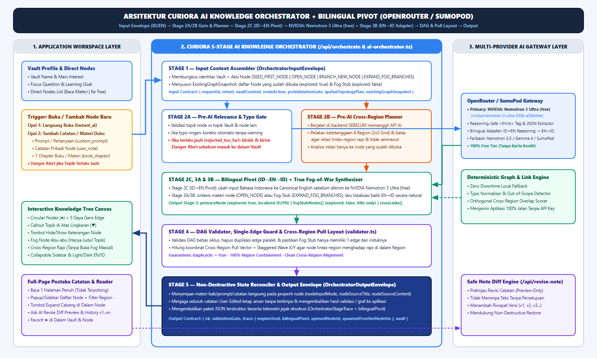
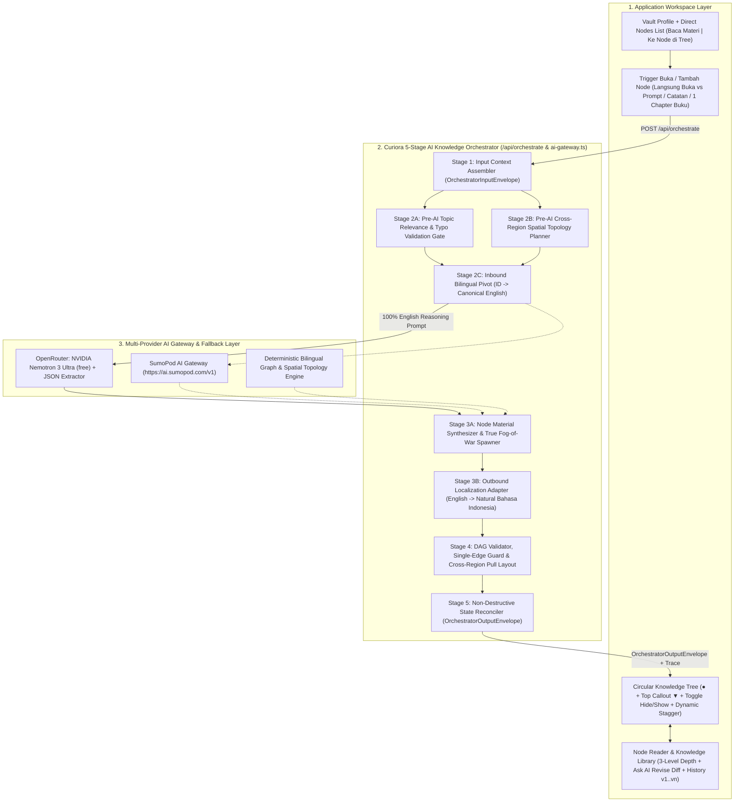

# Curiora — AI-Powered Knowledge Exploration Platform

> **Tagline:** *Where Curiosity Finds Its Way*  
> **Kompetisi:** LOGICODIX 2026 Hackathon Competition  
> **Kategori:** Web Application  
> **Subtema:** 1. Smart & Fun Education  
> **Repositori:** `https://github.com/shinoaaa/study-explore`

---

## 1. Identitas Tim & Proyek

- **Nama Aplikasi:** Curiora (*Curiosity Aurora*) — *Where Curiosity Finds Its Way*
- **Subtema:** Smart & Fun Education
- **Kategori:** Web
- **Target Pengguna:** Pelajar SMA/SMK/MA dan Mahasiswa yang ingin mengeksplorasi materi pelajaran lebih dalam maupun membangun jalur belajar mandiri berdasarkan minat dan tujuan personal.

---

## 2. Latar Belakang Masalah

1. **Keterbatasan Eksplorasi dari Materi Kurikulum (Kondisi A):**  
   Ketika pelajar membaca bab buku paket sekolah (misalnya Biologi bab *Sistem Pernapasan Manusia*) dan penasaran bagaimana oksigen yang dihirup digunakan oleh sel untuk mencetak energi, penjelasan di buku paket sering berhenti pada batas ruang lingkup bab tersebut. Pelajar tidak memiliki peta yang menghubungkan materi bab tersebut ke konsep lanjutan seperti *Hemoglobin*, *Respirasi Seluler*, *Metabolisme Energi*, *Bioenergetika*, maupun *VO2 Max*.
2. **Tersesat Saat Mengejar Minat Tanpa Peta Prasyarat (Kondisi B):**  
   Sebaliknya, pelajar yang memiliki minat atau tujuan spesifik (misalnya ingin memahami *Bagaimana Sel Kanker Berkembang*) sering langsung kewalahan saat membaca artikel ilmiah di internet karena melompat ke materi tingkat lanjut tanpa mengetahui anak tangga fondasi/prasyaratnya (*Biologi Sel* $\rightarrow$ *Struktur DNA* $\rightarrow$ *Mutasi Genetik* $\rightarrow$ *Regulasi Siklus Sel* $\rightarrow$ *Mekanisme Tumor*).
3. **Keterbatasan Chatbot & Mind Map Biasa:**  
   Mesin pencari dan *chatbot* linier hanya menjawab apa yang ditanyakan, padahal pelajar yang baru mulai belajar sering kali *"tidak tahu apa yang belum mereka ketahui"*.

**Solusi Curiora:**  
Platform berbasis AI yang **memetakan** materi pembelajaran maupun ketertarikan pribadi ke dalam peta pengetahuan interaktif (*Interactive Knowledge Graph*). Menggabungkan konsep **Knowledge Vault** (ruang catatan terisolasi layaknya *Obsidian*) dengan visualisasi **Regional Skill Tree** (peta berkuadran lintas-bidang layaknya *Path of Exile*) dalam antarmuka adaptif Light/Dark Mode dan dwibahasa (EN/ID).

---

## 3. Batasan Aplikasi & Aturan Bisnis (AI & System Guardrails)

Dokumen ini sekaligus menjadi acuan batasan sistem (*system boundaries*) yang wajib dipatuhi oleh seluruh komponen aplikasi:

### 3.1. Business Rules (BR) yang Mengikat Sistem
- **BR-01 (Vault Isolation Rule):** Pengguna tidak dapat melempar input di ruang kosong; setiap topik eksplorasi wajib dibuat di dalam sebuah **Knowledge Vault** tersendiri agar graf dan jejak eksplorasi antar-topik tidak tercampur.
- **BR-02 (Pemisahan Prasyarat vs Keterkaitan Biasa):** Tidak semua konsep yang berkaitan boleh dilabeli sebagai prasyarat (`prerequisite`). Label `prerequisite` hanya sah jika Konsep A mutlak harus dipahami terlebih dahulu sebelum Konsep B.
- **BR-03 (Kewajiban Alasan Hubungan / Mandatory Edge Reason):** Setiap garis penghubung (*edge*) antar-konsep wajib memiliki alasan ilmiah tertulis (`reason`) yang menjelaskan mengapa kedua konsep tersebut saling terhubung.
- **BR-04 (Sistem 6 Knowledge Regions ala Path of Exile & Hybrid Outward Region Containment):** Setiap node wajib dipetakan dan tergabung secara spasial di dalam batas wilayah salah satu dari 6 rumpun keilmuan:
  1. `REG-01`: **Natural & Life Sciences** (Biologi, Kimia, Fisika, Kebumian)
  2. `REG-02`: **Health, Medicine & Performance** (Kedokteran, Fisiologi, Gizi, Olahraga)
  3. `REG-03`: **Technology, Computing & AI** (Ilmu Komputer, Bioinformatika, Data Science, AI)
  4. `REG-04`: **Engineering & Applied Systems** (Teknik Biomedis, Elektro, Mesin, Lingkungan)
  5. `REG-05`: **Formal Logic & Mathematics** (Matematika, Statistika, Probabilitas)
  6. `REG-06`: **Social, Economy & Humanities** (Psikologi, Ekonomi, Kebijakan Publik, Humaniora)
- **NFR-09 (Region Containment & Hybrid Auto-Expanding Region Aura):** Setiap node wajib selalu berada di dalam batas wilayah Region-nya (tidak boleh keluar dari region). Secara visual wilayah Region tampil sebagai *Hybrid Soft Outward Aura* (dengan tombol toggle *Region Borders* opsional) yang otomatis membesar ke arah luar secara dinamis ketika node baru ditambahkan ke dalamnya.
- **NFR-10 (Adaptive Light & Dark Mode + Bilingual EN/ID + Clean Surface):** Seluruh antarmuka workspace—termasuk Dashboard, Create Vault, Library, Knowledge Tree Canvas, Outline View, dan Concept Reader modal—mendukung pergantian **Light Mode / Dark Mode** secara real-time, dukungan bahasa **Inggris & Indonesia (`EN | ID`)**, serta menyembunyikan kode teknis internal (`REG-01`..`REG-06`, `Mode A`/`Mode B`) dari tampilan pengguna akhir agar antarmuka tetap bersih dan intuitif.
- **NFR-11 (Unbounded Open Exploration / No Completion Cap):** Eksplorasi di dalam Vault bersifat terbuka tanpa batas akhir seperti Vault Obsidian. Sistem dilarang membatasi jumlah total node per Vault maupun menampilkan *progress bar* persentase (0–100% selesai); telemetri hanya mencatat jumlah node terpetakan, terbuka, dipahami, dan Region terjamah.
- **BR-05 (Anti-Filter Bubble Rule):** Meskipun jalur disesuaikan dengan minat pengguna, setiap Vault wajib menyertakan minimal 1 cabang lintas disiplin (`cross_disciplinary` / lintas-Region) untuk membuka wawasan bidang baru.
- **BR-06 (DAG & Anti-Orphan Validation):** Struktur graf wajib berupa *Directed Acyclic Graph* (DAG) tanpa siklus pada relasi `prerequisite`, tanpa duplikasi node, dan setiap `source`/`target` pada *edge* wajib merujuk ke ID node yang valid.
- **BR-07 (Kesamaan Mesin Mode A & Mode B):** Eksplorasi dari Materi Kurikulum (Mode A) dan Eksplorasi dari Minat/Tujuan (Mode B) diproses menggunakan mesin *Graph Builder*, sistem 6 Region, dan skema JSON yang sama.
- **BR-08 (Kepatuhan Hak Cipta / Copyright Rule):** Penjelasan modul wajib berupa sintesis konseptual mandiri dengan atribusi referensi terbuka/terpercaya (bukan salinan tekstual buku cetak berhak cipta).
- **BR-09 (Progressive Disclosure & Unbounded Growth):** Pembangkitan awal di dalam Vault dimulai dari 5–8 node inti (dengan mekanisme *Fog of War*) agar tidak *Information Overload*, namun ekspansi selanjutnya bersifat terbuka tanpa batas maksimum node dan tanpa target penyelesaian 100%.

### 3.2. Batasan Fitur (Out-of-Scope MVP)
Untuk menjaga keakuratan hubungan konsep dan stabilitas aplikasi:
- Tidak melakukan upload/OCR otomatis terhadap file PDF buku cetak berhak cipta.
- Tidak melakukan *AI image generation* otomatis pada setiap node.
- Tidak menerapkan *adaptive quiz* multi-soal yang kompleks atau *mathematical knowledge tracing* jangka panjang (cukup *1-Click Quick Check* per node).
- Tidak mewajibkan registrasi akun berbayar atau autentikasi tertutup bagi penguji/juri.

---

## 4. Fitur Utama yang Diimplementasikan

1. **Identity-First Vault Manager & Collapsible Clean Sidebar (`FEAT-01`):** Buat Vault baru secara ringkas dari identitas (*Vault Name*, *Main Interest*, *Short Description*, *Focus Question*, *Learning Goal*, *Related Interests* tags, dan *Preferred Starting Depth*), filter **`All Vaults` | `★ Has Favorites`**, kelola di `localStorage`, serta jelajahi 3 *Preset Vault* (*Biologi Medis*, *Fisiologi Olahraga*, dan *Riset Onkologi/Kanker*). Sidebar kiri dapat ditutup/dibuka (*Collapsible Sidebar*) dan daftar *Recent Vaults* dibuat bersih tanpa lencana bintang berlebihan.
2. **Streamlined Vault Overview — Direct Nodes Section (`Overview` | `Knowledge Tree` | `Knowledge Library`):** Di bawah kartu **Vault Profile**, tampilan *Vault Overview* langsung menyajikan bagian **Nodes** tanpa kotak statistik yang membingungkan. Setiap kartu Node memiliki tombol bintang **Favorite ★** di dalam Vault serta **2 tombol aksi langsung**:
   - **Baca Materi (`Read Material` / `Buka Node`)** — langsung membaca materi node atau membuka node baru.
   - **Ke Node di Tree (`View in Tree`)** — langsung melompat dan memfokuskan node tersebut di kanvas *Knowledge Tree*.
3. **Node-Centric Material Input, Pre-Join Relevance Gate & True Fog-of-War Lifecycle (`FEAT-02`):**
   - Saat membuka node baru (atau menambah cabang node baru), pengguna diberi **2 pilihan utama**:
     - **Langsung Buka (`Open Directly`):** AI langsung menyintesis materi node dari konteks Vault & prasyaratnya.
     - **Tambah Catatan / Materi Dulu (`Add Note / Material First`):** Pengguna dapat memasukkan **Prompt / Pertanyaan Fokus**, **Catatan Pribadi**, atau **1 Chapter Buku / Materi** langsung ke dalam node tersebut sebelum dibuka.
   - **Pre-Join Topic Relevance & Typo Gate:** Sebelum node baru masuk ke Vault, orkestrator memeriksa keterkaitannya dengan topik Vault & node yang ada. Jika ada *typo* ringan, ejaan dikoreksi otomatis dan langsung masuk tanpa peringatan; jika topik terlalu jauh dari fokus Vault (`rejected_too_far`), modal menampilkan peringatan **Danger** dan memblokir node tersebut.
   - **True Fog-of-War Lifecycle (Tanpa Buka Fog Massal):** Node yang belum dibuka (`explored: false`) berwarna abu-abu dan **hanya memiliki judul topik (`title`)** tanpa isi materi maupun relasi ke node lain. Saat node dibuka (`OPEN_NODE`), AI men-generate materi khusus untuk node tersebut (tanpa otomatis membuka node lain). Untuk memekarkan cabang baru, pengguna menekan tombol **Kembangkan Cabang (`Expand Branches`)** di dalam node yang sudah dibuka (`EXPAND_FOG_BRANCHES`), yang menghasilkan *Fog Stub* abu-abu baru.
4. **Curiora 5-Stage AI Knowledge Orchestrator & Pre-AI Cross-Region Spatial Planner (`/api/orchestrate`):** Orkestrator AI 5-tahap (`src/lib/ai-orchestrator.ts`) menjalankan **Pre-AI Cross-Region Spatial Planner** sebelum memanggil API AI untuk memetakan ketetanggaan 6 Knowledge Regions pada grid 2x3, menjaga relasi lintas-region hanya ke node yang sudah dibuka pada Region tetangga ortogonal, serta menata posisi node dengan *Cross-Region Pull Vector* (`validator.ts`) agar garis lintas-region rapi dan tidak semrawut.
5. **Circular Skill Tree Nodes, Topic Callout Box & Dynamic Staggered Layout (`FEAT-04` & `FEAT-05`):**
   - Setiap node dirender sebagai **lingkaran bersih (`r = 22px`)** yang dihubungkan oleh 5 gaya garis *edge* (`prerequisite`, `extension`, `application`, `related_concept`, `cross_disciplinary`).
   - Topik node tampil sebagai **kotak keterangan (*callout box*) dengan panah segitiga (`▼`) tepat di atas lingkaran node**.
   - Dilengkapi tombol ikon **Hide / Show Node Labels** di toolbar kanvas (tanpa teks keterangan bertele-tele): ketika dalam mode *Hide*, seluruh label di atas node disembunyikan agar peta bersih, namun **ketika salah satu lingkaran node diklik, keterangan node yang dipilih tersebut langsung muncul sendiri**.
   - Posisi lingkaran node diatur secara **dinamis maju-mundur (*Organic Wave Stagger X/Y*)** dan menghadap ke Region pasangannya di dalam batas *Region Aura*.
6. **Full-Page Pustaka Catatan (Knowledge Library), Popup/Sidebar Daftar Node & Filter by Region (`FEAT-06`):** Halaman **Pustaka Catatan** dirancang sebagai pembaca **1 halaman penuh (*Full-Page Single-Column Node Reader*)** yang lega dan tidak terpotong-potong, dilengkapi tombol **Daftar Node** berupa *Popup / Slide-Over Sidebar*, **Filter by Region** (`Semua Bidang` + 6 *Knowledge Regions*), tombol **Favorites ★**, **Edit Catatan**, **`Minta AI Revisi`** dengan pratinjau diff (`/api/revise-note`), **Kembangkan Cabang**, serta **`Riwayat Revisi`** (`v1`..`vn`).
7. **Bilingual EN/ID, Light/Dark Mode & Zero Internal Code Leak (`FEAT-07`–`FEAT-09`):** Beralih tema **Light/Dark** dan bahasa **EN/ID**, 3 tingkat kedalaman penjelasan (*Simple/Standard/Deep*), *1-Click Quick Check*, serta filter ketat yang menjamin nol kebocoran kode internal lomba di UI.

---

## 5. Arsitektur Curiora 5-Stage AI Knowledge Orchestrator & Kontrak Data

Diagram arsitektur lengkap tersedia dalam format **Draw.io** yang dapat disunting di [`docs/Curiora_AI_Orchestrator_Architecture.drawio`](docs/Curiora_AI_Orchestrator_Architecture.drawio) dan gambar beresolusi tinggi di [`docs/Curiora_AI_Orchestrator_Architecture.png`](docs/Curiora_AI_Orchestrator_Architecture.png):





### Kontrak JSON Masuk & Keluar Orkestrator (`src/types/knowledge.ts`)
- **Kontrak Input (`OrchestratorInputEnvelope`):**
  - `requestId`, `intent` (`SEED_FIRST_NODE` | `OPEN_NODE` | `BRANCH_NEW_NODE` | `EXPAND_FOG_BRANCHES` | `ANALYZE_RELATIONS`), `lang` (`en` | `id`)
  - `vaultContext`: `{ vaultId, vaultName, identity }`
  - `nodeAction`: `{ targetNodeId?, parentNodeId?, nodeTitle?, openMode: 'instant_ai' | 'custom_prompt' | 'user_note' | 'book_chapter', inputTitle?, inputContent?, preferredDepth? }`
  - `preValidationGate`: `{ status: 'valid' | 'typo_corrected' | 'rejected_too_far', originalTitle, normalizedTitle, dangerMessage? }`
  - `spatialTopologyPlan`: `{ primaryRegion, adjacentRegionCandidates, activeRegions, regionNodeCounts, maxCrossRegionLinksPerNode, layoutDirective }`
  - `bilingualPivot`: `{ userLang, pivotLang: 'en', inboundTranslatedToEn, outboundLocalizedToId, canonicalEnglishTopic, canonicalEnglishVaultInterest, reasoningProvider, reasoningModel, localizationModel }`
  - `existingGraphSnapshot`: daftar ringkas node yang sudah dibuka (`explored: true`) maupun *Fog Stub* (`explored: false`).
- **Kontrak Output (`OrchestratorOutputEnvelope`):**
  - `ok`: `boolean`, `validationGate`: hasil gerbang validasi topik/typo, `vault`: objek `KnowledgeVault` yang telah divalidasi DAG & ditata ulang posisinya dengan *Cross-Region Pull Vector*.
  - `trace` (`OrchestratorStageTrace`): `{ requestId, intent, engineUsed, bilingualPivot, validationStatus, openedNodeId, spawnedFrontierNodeIds, crossLinksDiscovered, dagValid, processedAt }`.

---

## 6. Teknologi yang Digunakan

- **Framework:** Next.js (App Router, TypeScript)
- **Styling & UI:** Tailwind CSS, Lucide React Icons, Custom SVG Directed Acyclic Graph Renderer
- **AI / LLM Integration (`src/lib/ai-gateway.ts` & `src/lib/ai-orchestrator.ts`):**
  - **Primary Free Reasoning Model:** **OpenRouter** (`https://openrouter.ai/api/v1`) dengan **`NVIDIA: Nemotron 3 Ultra (free)`** (`nvidia/nemotron-3-ultra-550b-a55b:free`) + **Bilingual Pivot Pipeline (`ID -> EN -> Nemotron 3 Ultra -> EN -> ID`)** & `<think>`-safe JSON Extractor.
  - **Alternative Fast Gateway:** **SumoPod AI Gateway** (`https://ai.sumopod.com/v1`) atau **Google Gemini** (`gemini-2.5-flash`).
  - **Zero-Downtime Fallback:** *Deterministic Bilingual Graph & Spatial Topology Engine*.
- **State & Storage:** React Hooks + Browser `localStorage` (Zero-friction Vault, Light/Dark Mode, & EN/ID preference persistence tanpa login)

---

## 7. Panduan Instalasi & Konfigurasi OpenRouter / SumoPod (`.env.local`)

1. **Clone repositori & instal dependensi:**
   ```bash
   git clone https://github.com/shinoaaa/study-explore.git
   cd study-explore
   npm install
   ```

2. **Salin file `.env.example` menjadi `.env.local`:**
   ```bash
   cp .env.example .env.local
   ```

3. **Pilih Opsi Gateway AI di `.env.local`:**

   ### Opsi A (Default — 100% Gratis Tanpa Kartu Kredit): OpenRouter + `NVIDIA: Nemotron 3 Ultra (free)`
   1. Buka [https://openrouter.ai/settings/keys](https://openrouter.ai/settings/keys) dan login menggunakan akun Google atau GitHub (tidak perlu kartu kredit).
   2. Klik **Create Key**, beri nama bebas (mis. `curiora-dev`), lalu salin key (`sk-or-v1-...`).
   3. Tempel ke dalam `.env.local`:
      ```env
      AI_PROVIDER=openrouter
      OPENROUTER_API_KEY=sk-or-v1-xxxxxxxxxxxxxxxxxxxxxxxxxxxxxxxx
      OPENROUTER_MODEL=nvidia/nemotron-3-ultra-550b-a55b:free
      OPENROUTER_TRANSLATOR_MODEL=google/gemma-4-31b-it:free
      ```
   *(Catatan Arsitektur: Karena `NVIDIA: Nemotron 3 Ultra (free)` memiliki penalaran sains terbaik dalam Bahasa Inggris, Curiora otomatis menerjemahkan input Bahasa Indonesia ke Bahasa Inggris (`Stage 2C`), menjalankan penalaran penuh di Nemotron 3 Ultra (`Stage 3A`), lalu menerjemahkan hasilnya kembali ke Bahasa Indonesia (`Stage 3B`)).*

   ### Opsi B (Alternatif Ngebut & Stabil): SumoPod AI Gateway
   Jika ingin respons yang lebih cepat tanpa antrean model `:free` publik OpenRouter:
   1. Buka dashboard [https://sumopod.com](https://sumopod.com) $\rightarrow$ menu **API Keys** $\rightarrow$ buat API Key baru (`sk-...`).
   2. Tempel ke dalam `.env.local`:
      ```env
      AI_PROVIDER=sumopod
      SUMOPOD_API_KEY=sk-xxxxxxxxxxxxxxxxxxxxxxxxxxxxxxxx
      SUMOPOD_BASE_URL=https://ai.sumopod.com/v1
      SUMOPOD_MODEL=gpt-4o-mini
      ```

   *(Catatan: Jika semua variabel API Key dikosongkan, aplikasi tetap berjalan 100% menggunakan **Smart Deterministic Bilingual Synthesis Engine** dan 3 **Preset Vaults** bawaan).*

4. **Jalankan server development:**
   ```bash
   npm run dev
   ```
   Buka `http://localhost:3000` di browser.

---

## 8. Dokumentasi Penggunaan AI & Atribusi

- **Model AI yang Digunakan:**
  - **OpenRouter:** `nvidia/nemotron-3-ultra-550b-a55b:free` (**NVIDIA: Nemotron 3 Ultra (free)**) dengan rantai fallback gratis (`nvidia/nemotron-3.5-lightning:free` & `google/gemma-4-31b-it:free`).
  - **SumoPod AI Gateway / Google Gemini (Opsional):** `gpt-4o-mini` / `gemini-2.5-flash`.
- **Bagian Produk yang Memanfaatkan AI:**
  1. `/api/orchestrate` (**Curiora 5-Stage AI Knowledge Orchestrator** — `src/lib/ai-orchestrator.ts`): Menerima paket terstruktur `OrchestratorInputEnvelope` saat pengguna memilih **Langsung Buka (`instant_ai`)** atau **Tambah Catatan / Materi Dulu (`custom_prompt`, `user_note`, `book_chapter`)** pada sebuah node, menjalankan **Cross-Node Relation Analyzer** untuk mendeteksi hubungan ilmiah dengan seluruh node yang sudah ada di Vault, memekarkan *Frontier Nodes* baru dalam status *Fog of War*, memvalidasi DAG & posisi organik (`validator.ts`), serta mengembalikan `OrchestratorOutputEnvelope` beserta `OrchestratorStageTrace`.
  2. `/api/explore` & `/api/expand`: Mendukung inisialisasi peta pengetahuan dan pemekaran cabang kontekstual dari node yang dipilih pengguna di dalam Vault.
  3. `/api/revise-note`: Menghasilkan pratinjau revisi catatan yang diminta pengguna di **Knowledge Library** tanpa menimpa teks sebelum pengguna mengklik *Apply Revision*.
- **Atribusi Referensi Materi Terbuka:**
  - *OpenStax Biology 2e* (Rice University, CC BY 4.0 License)
  - *Campbell Biology 12th Edition* & *Guyton and Hall Textbook of Medical Physiology* (Rujukan bibliografi konsep)
- **Atribusi Pustaka Open-Source:** Next.js (MIT), React (MIT), Tailwind CSS (MIT), Lucide Icons (ISC).

---

## 9. Aturan Commit & Standar Repositori (LOGICODIX 2026)

Seluruh riwayat pengembangan pada repositori ini mengikuti tata tertib repositori **LOGICODIX 2026**:

1. **Conventional Commits:** Setiap commit menggunakan prefiks standar yang jelas sesuai ruang lingkup perubahan:
   - `feat:` — penambahan fitur aplikasi, komponen UI, maupun endpoint API baru.
   - `fix:` — perbaikan bug, validasi DAG/Region, atau penyesuaian tampilan.
   - `docs:` — pembaruan dokumentasi (`README.md`, spesifikasi MVP, recap).
   - `refactor:` — perombakan struktur kode/desain internal tanpa mengubah kontrak utama.
   - `chore:` — konfigurasi environment, dependensi, atau pemeliharaan repositori.
2. **Incremental History (Dilarang Bulk Upload):** Perubahan dikomit secara bertahap per modul/fitur yang bermakna, bukan mengunggah seluruh proyek sekaligus dalam satu commit raksasa.
3. **Riwayat Git Bersih & Jujur:** Dilarang keras melakukan `git push --force`, `git rebase` pada branch publik, atau `git squash` untuk memanipulasi/menghilangkan jejak pengerjaan. Seluruh commit sah dikerjakan dalam rentang waktu kompetisi (**7 Nov 2026** hingga *code freeze* **14 Nov 2026 pukul 23:59 WIB**).
4. **Keamanan Kredensial & Kelayakan Deploy:** File rahasia (`.env`, API key pribadi) wajib tetap berada di `.gitignore` dan tidak pernah dikomit; gunakan `.env.example` sebagai templat variabel lingkungan agar aplikasi dapat langsung dijalankan di `localhost` maupun di-deploy.
